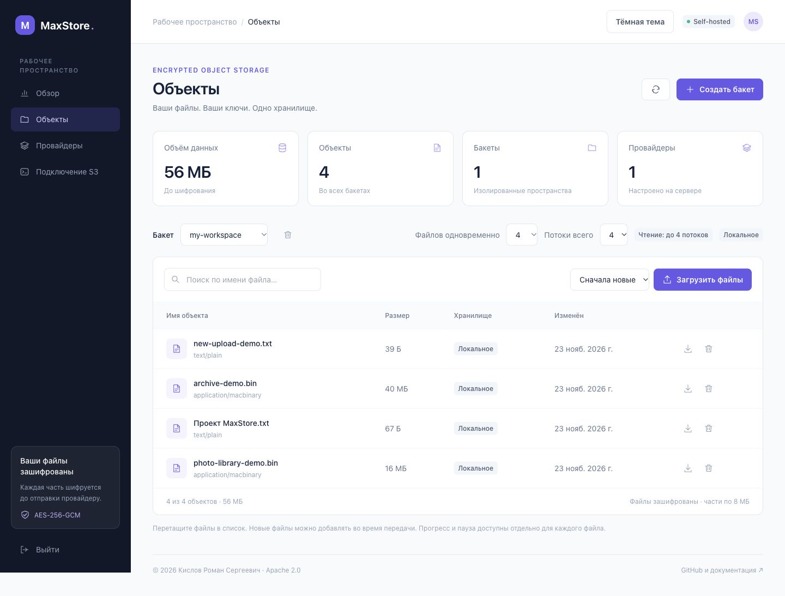

# MaxStore

**Личное объектное хранилище на Go: Telegram, MAX и локальный диск с S3 API и интерфейсом на Tailwind CSS.**

Автор: **Кислов Роман Сергеевич**. Лицензия: [Apache 2.0](LICENSE).

MaxStore делит файлы на части по 8 МиБ, шифрует их AES-256-GCM и сохраняет у выбранного провайдера. Каталог объектов и ключ шифрования остаются на вашем сервере. Работа с файлами доступна из браузера, AWS CLI, AWS SDK и rclone.



[Тёмная тема](docs/images/console-dark.jpg)

## Возможности

- Независимая очередь файлов: новые файлы можно добавлять во время передачи; пауза, продолжение и повтор доступны отдельно для каждого файла.
- Общий пул из 1–16 потоков загрузки и отдельный пул скачивания. Несколько файлов делят доступные потоки, большой файл не блокирует новые.
- Возобновляемая загрузка: после обновления страницы повторно выберите тот же файл, уже принятые части пропускаются.
- Потоковое скачивание с параллельной подкачкой частей и HTTP Range. Файл целиком не собирается в оперативной памяти или временном файле.
- S3: бакеты, списки, PUT/GET/HEAD/DELETE, multipart, копирование, массовое удаление, метаданные, теги, условная запись и presigned URLs.
- Вход по логину и паролю, bcrypt, серверные сессии, защита от CSRF; независимые S3-ключи.
- Светлая и тёмная тема, адаптивная консоль, поиск, сортировка и выбор провайдера для каждого бакета.
- Один исполняемый файл со встроенным интерфейсом, Docker Compose и автоматические проверки GitHub Actions.

Это совместимое подмножество S3 для основных файловых операций, а не полная реализация Amazon S3. Точный перечень и настройки клиентов: [совместимость S3](docs/s3.md).

## Быстрый запуск

Нужен Go 1.25+. Собранные стили уже включены в исходники, Node.js нужен только для их изменения.

```sh
git clone https://github.com/rkislov/maxstore.git
cd maxstore
go run ./cmd/maxstore
```

Откройте [http://127.0.0.1:8080](http://127.0.0.1:8080). Логин и начальный пароль появятся в `data/credentials.json`: `admin_username` и `admin_password`. Создайте бакет с провайдером «Локальное» и загрузите файлы.

Для Telegram добавьте настройки окружения, перезапустите сервер и создайте бакет с провайдером Telegram:

```sh
cp .env.example .env
# Отредактируйте .env: TELEGRAM_BOT_TOKEN и TELEGRAM_CHAT_ID
set -a
. ./.env
set +a
go run ./cmd/maxstore
```

Сам Go-сервер не читает `.env` автоматически. Файл читает Docker Compose либо ваша оболочка.

## Docker

```sh
cp .env.example .env
# При необходимости настройте Telegram в .env
docker compose up -d --build
docker compose exec maxstore cat /data/credentials.json
```

Порты консоли `8080` и S3 `9000` опубликованы только на localhost. Данные находятся в именованном томе `maxstore-data`. Контейнер работает от непривилегированного пользователя. Инструкции для HTTPS и резервных копий: [эксплуатация](docs/operations.md).

## Подключение S3

Понадобятся AWS CLI и jq. Значения ключей берутся из локального файла; реальные ключи не включены в репозиторий.

```sh
export AWS_ACCESS_KEY_ID="$(jq -r .s3_access_key data/credentials.json)"
export AWS_SECRET_ACCESS_KEY="$(jq -r .s3_secret_key data/credentials.json)"
export AWS_DEFAULT_REGION=us-east-1
export AWS_REQUEST_CHECKSUM_CALCULATION=when_required
export AWS_RESPONSE_CHECKSUM_VALIDATION=when_required
aws configure set default.s3.addressing_style path
aws --endpoint-url http://127.0.0.1:9000 s3 mb s3://my-backups
aws --endpoint-url http://127.0.0.1:9000 s3 cp ./README.md s3://my-backups/README.md
aws --endpoint-url http://127.0.0.1:9000 s3 cp s3://my-backups/README.md ./downloaded.md
```

Провайдер бакета, созданного через S3, определяется `DEFAULT_PROVIDER`. В консоли его можно выбрать при создании. Примеры SDK, rclone, multipart и presigned URLs: [S3](docs/s3.md).

## Документация

- [Настройка Telegram и MAX](docs/providers.md)
- [Все переменные окружения](docs/configuration.md)
- [Операции S3 и настройки клиентов](docs/s3.md)
- [HTTP API и возобновляемая загрузка](docs/api.md)
- [Архитектура и целостность данных](docs/architecture.md)
- [Запуск, HTTPS, резервное копирование и обновление](docs/operations.md)
- [Разработка, тесты и выпуск](docs/development.md)
- [Безопасность](SECURITY.md), [участие в разработке](CONTRIBUTING.md), [история изменений](CHANGELOG.md)

## Размеры и ограничения

`MAX_OBJECT_SIZE=0` отключает настроенный лимит размера объекта. Это не обещание бесконечного места: остаются ограничения файловой системы, int64, метаданных, S3 multipart и самого провайдера. Части интерфейса имеют размер 8 МиБ; S3 multipart поддерживает до 10 000 частей по 5 МиБ–5 ГиБ, последняя может быть меньше.

Telegram и MAX не предоставляют MaxStore гарантий хранения или SLA. Удаление сообщений, потеря доступа к боту или изменение API могут сделать данные недоступными. Для важных файлов нужна отдельная резервная копия. **Храните `metadata.db` и `master.key` вместе: без них восстановить каталог и расшифровать части нельзя.** Данные в Telegram хранятся через Bot API, пользовательский клиент не используется. MAX проверяется тестами адаптера; доступность с вашим ботом нужно проверить отдельно.

## Проверка проекта

```sh
npm ci
npm test
npm run build:css
go test -race ./...
go vet ./...
go build -trimpath -o bin/maxstore ./cmd/maxstore
```

Для воспроизводимой проверки реальных клиентов: `python3 scripts/s3-smoke.py` (нужны AWS CLI и rclone в PATH). Скрипт запускает отдельный локальный сервер на портах 18080/19000 и использует только временные тестовые данные.
